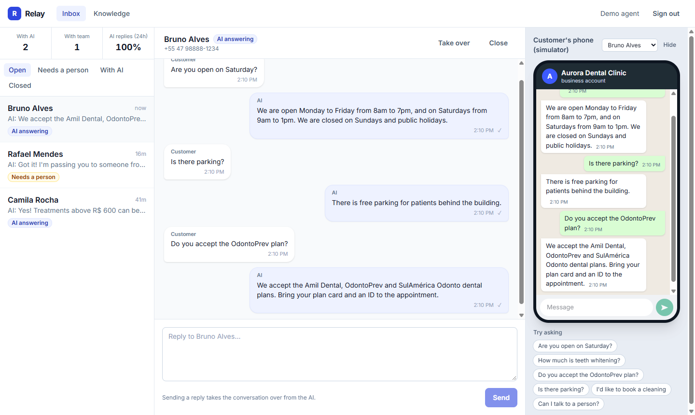
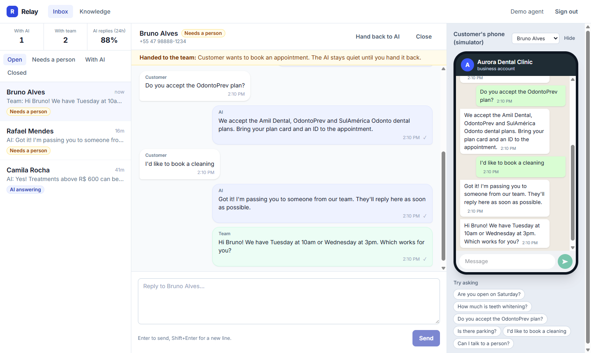
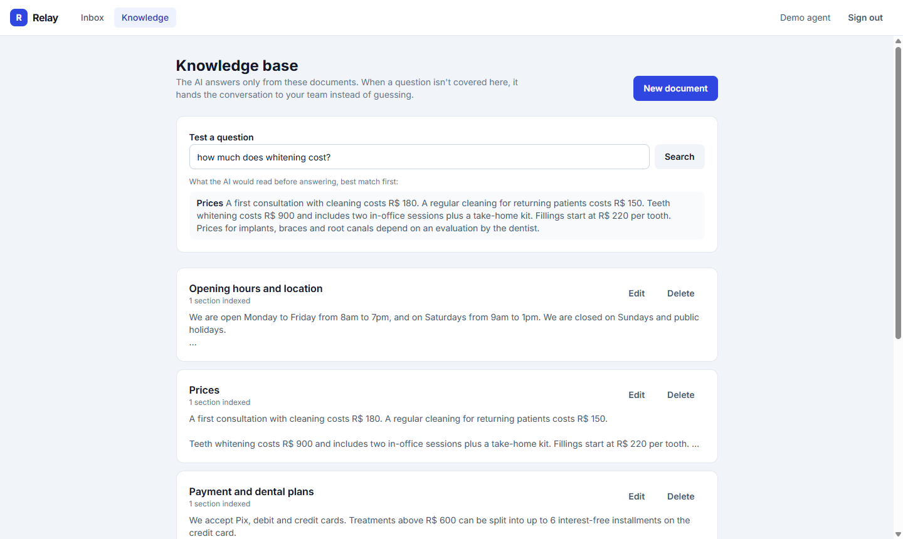

# Relay: WhatsApp AI agent with human handoff

[](https://github.com/fontanella01/whatsapp-ai-agent/actions/workflows/ci.yml)

An AI agent that answers a business's WhatsApp messages from its own knowledge base, and hands the
conversation to a person when it can't help: when the customer asks for one, wants to book or cancel,
or asks something the knowledge base doesn't cover. The team follows every conversation live in an
inbox, can take over at any moment and give the conversation back to the AI.

It works with the real **WhatsApp Cloud API** (Meta) and ships with a **phone simulator**, so anyone can
try the whole flow without a WhatsApp Business account.

**Stack:** React · TypeScript · Vite · Tailwind CSS · Node.js · Fastify · PostgreSQL · Drizzle ORM · Zod · Vitest · Claude API · Docker



| Handoff to the team | Knowledge base |
|---|---|
|  |  |

## What it does

- **Answers from a knowledge base (RAG).** Documents (hours, prices, policies) are split into small sections and indexed with PostgreSQL full-text search. For each question, only the matching sections go to the model, which is told to answer from them and nothing else.
- **Knows when to call a person.** Asking for a human, booking, cancelling, complaining, or a question the knowledge base doesn't cover hands the conversation to the team with the reason shown in the inbox. From then on the AI stays quiet until an agent gives the conversation back.
- **Live inbox.** New messages, AI replies and handoffs appear without refreshing (Server-Sent Events). Filters for "Needs a person", "With AI" and "Closed".
- **Agents in control.** Take over, reply, hand back to the AI, close. Replying to a conversation the AI is handling takes it over, so the customer never gets two voices at once.
- **Phone simulator.** Plays the customer side through exactly the same code path as a real WhatsApp webhook.
- **Free demo mode.** Without an API key, a rule-based responder quotes the best matching sentences from the knowledge base and applies the same handoff rules.

## How a message flows

```
WhatsApp (Meta) ──webhook──▶ verify signature ─▶ save message (idempotent) ─▶ queue "reply" job ─▶ 200 OK
Phone simulator ───────────────────────────────▶      (same function)

worker ─▶ claim job ─▶ AI in charge? ─▶ wants a person? ──yes──▶ handoff
                                         │ no
                                         ▼
                          search knowledge base ─▶ Claude (structured output) ─▶ reply or handoff
                                                                                    │
                                         queue "send" job ◀─────────────────────────┘
worker ─▶ send through WhatsApp API ─▶ mark sent ─▶ live event to the inbox and the simulator
```

## Design decisions

- **The webhook does almost nothing.** Meta expects a fast `200` and retries otherwise, so the webhook only verifies the signature, saves the message and queues a job. The AI call happens later, in a worker.
- **The queue lives in PostgreSQL.** Jobs are rows claimed with `FOR UPDATE SKIP LOCKED`, so several workers can poll safely, and a job is created in the same transaction as the message it refers to: it can't be lost or point to nothing. No Redis to run.
- **Retries with backoff, and a plan when they run out.** A failed send is retried after 2s, 4s and 8s; errors a retry can't fix (expired token, invalid number) fail at once. A message that can't be delivered is marked as such in the inbox, and if the AI keeps failing the conversation goes to a person instead of leaving the customer waiting.
- **Idempotency.** WhatsApp message ids are `UNIQUE` in the database, so a webhook delivered twice creates one message and one reply. A send job checks whether the message already went out before sending, so a retry never sends twice.
- **Bursts get one answer.** Customers often send three short messages in a row. The reply job waits 1.5s and is pushed back on each new message (one pending reply per conversation, enforced by a partial unique index), so the AI reads all three and answers once.
- **Webhook authenticity.** Every Meta request is checked with HMAC-SHA256 over the raw body (`X-Hub-Signature-256`) using a constant-time comparison; tampered or unsigned requests get `401`.
- **The model answers in a fixed shape.** Claude returns `{ reply, handoff, handoff_reason }` through structured output validated by Zod, with low effort to keep replies fast. Customer messages and documents are passed as data inside tags and the prompt says to ignore instructions found in them (prompt injection). If the model declines, the API's server-side fallback retries on another model, and a remaining refusal becomes a handoff.
- **AI and channel behind interfaces.** The worker only knows `responder.reply()` and `channel.send()`. Production uses Claude and the WhatsApp Cloud API; the demo uses the rule-based responder and the simulator; tests use fakes and a controllable clock.
- **Messages are ordered by arrival** (an identity column), not only by timestamp, so two messages saved in the same millisecond still read in the right order.

## Running locally

Requires Node.js 22+.

```bash
npm install
cp apps/api/.env.example apps/api/.env    # set JWT_SECRET; add DEMO_MODE=true for the sample clinic
npm run dev:api    # http://localhost:3333 (PostgreSQL runs embedded, nothing to install)
npm run dev:web    # http://localhost:5174
```

With `DEMO_MODE=true`, the login page shows **Try the demo**: a sample dental clinic with a knowledge base and two conversations. Write as a customer on the phone on the right.

If port 3333 is taken, run the API with `PORT=3334` and the web app with `API_PORT=3334`.

### With Docker

```bash
docker compose up --build    # http://localhost:3333, with a real PostgreSQL
```

One image serves the API and the built web app.

## Connecting a real WhatsApp number

1. Create an app in Meta for Developers with the WhatsApp product and get a phone number id and a token.
2. Set `WHATSAPP_TOKEN`, `WHATSAPP_PHONE_NUMBER_ID`, `WHATSAPP_APP_SECRET` and a `WHATSAPP_VERIFY_TOKEN` of your choice.
3. Register `https://<your-host>/webhooks/whatsapp` as the webhook URL with that verify token and subscribe to `messages`.

Without these variables the app uses the simulator only.

## Tests

```bash
npm test          # 36 tests
npm run typecheck
```

Covered: AI replies with the right knowledge, burst debounce, every handoff path, agents taking over and handing back, reopening closed conversations, retries with backoff, permanent failures, the AI failing repeatedly, webhook verification and signatures (including tampered bodies), duplicate deliveries, retrieval quality on the demo documents, re-indexing, login and the demo account, and serving the web app. Every test starts a fresh in-memory PostgreSQL; none calls a real AI or WhatsApp.

## Configuration (apps/api/.env)

| Variable | Required | Purpose |
|---|---|---|
| `JWT_SECRET` | yes | Signs login tokens (32+ random characters) |
| `DATABASE_URL` | no | PostgreSQL connection; embedded PGlite in `./.data` when absent |
| `ANTHROPIC_API_KEY` | no | Enables Claude; demo responder when absent |
| `AI_MODEL` | no | Claude model id (default `claude-opus-5-5`) |
| `BUSINESS_NAME` | no | Name the AI uses for the business |
| `WHATSAPP_*` | no | Real WhatsApp Cloud API (see above) |
| `DEMO_MODE` | no | `true` creates the sample clinic and shows "Try the demo" |
| `WEB_DIR` | no | Serve the built web app from this folder (set in the Docker image) |

## Limits and next steps

- **Retrieval is lexical.** Full-text search matches words and their variations, not meaning: "it hurts" won't find "severe pain". Embeddings with pgvector would fix that; the retrieval function is the only place that would change.
- Live events use an in-process bus, which fits one API instance. With several instances they would move to PostgreSQL `LISTEN/NOTIFY` or Redis.
- Media messages (audio, images) are ignored; only text is handled.
- One business per installation. Making it multi-tenant would follow the same pattern as my [HelpDesk](https://github.com/fontanella01/helpdesk) project.
- The login token is kept in `localStorage`; an httpOnly cookie would be safer.

---

Built by [Vinícius Fontanella Kleis](https://www.linkedin.com/in/vinicius-fontanella/).
